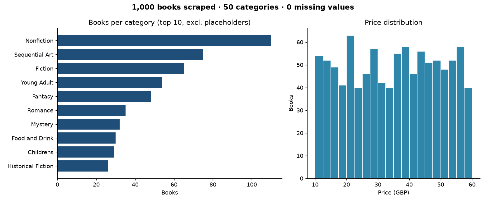

# Book Catalog Scraper

A production-style Python web scraper that collects an entire online catalog and delivers a clean dataset plus a formatted Excel report.



> Target: [books.toscrape.com](https://books.toscrape.com), a public sandbox built for scraping practice. The same approach applies to e-commerce product/price monitoring, real-estate listings, directories, etc.

## What it does

- Crawls **all 50 listing pages** (pagination detected automatically) and visits **1,000 product pages**.
- Extracts title, category, price, star rating, availability, units in stock and product code (UPC).
- Exports:
  - `books.csv`: raw dataset, ready for databases or BI tools.
  - `books_report.xlsx`: formatted Excel with frozen header, filters, currency format, a **per-category summary** sheet and a **native Excel chart**.

**Result:** 1,000 books, 50 categories, **0 missing values, 0 duplicates**, in about 1.5 minutes.

## Engineering details

- **Polite and robust:** configurable delay, automatic retries with exponential backoff on 429/5xx, timeouts, custom User-Agent.
- **Concurrent detail fetching** with a small thread pool (`--workers`).
- **Parsing separated from networking:** pure functions, unit-tested offline with HTML fixtures (`pytest`).
- **CLI:** `--pages`, `--workers`, `--delay`, `--out`.

## Run it

```bash
pip install -r requirements.txt
python -m pytest -q          # offline tests
python scraper.py            # full catalog
python scraper.py --pages 2  # quick sample
python make_preview.py       # regenerate the chart above
```

## Need something similar?

Prices, products, listings, leads or any public data delivered as Excel/CSV/JSON or straight into your database, on a schedule if you need it.
